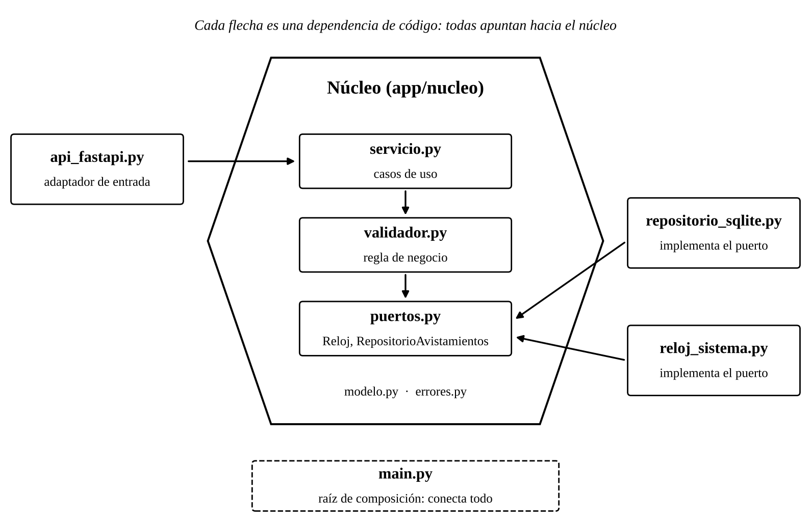

# Taller 5: Clean Architecture y arquitectura hexagonal

Ingeniería de Software 2 (ISW-2)  
Martin Daniel Porto Gutierrez  
Universidad El Bosque, 11 de noviembre de 2026  

## 1. Parte 1. Investigación

### Pregunta 1. Cockburn (2005): el problema, puertos, adaptadores y simetría

[Escribir aquí la respuesta con sus palabras, citando (Cockburn, 2005).]

### Pregunta 2. Martin (2012): los círculos y la regla de dependencia

[Escribir aquí la respuesta con sus palabras, citando (Martin, 2012).]

### Pregunta 3. Cómo guarda datos el caso de uso sin depender de la base de datos

[Escribir aquí la respuesta con un ejemplo, citando (Martin, 2012).]

### Pregunta 4. Comparación entre hexagonal, cebolla y Clean Architecture

[Escribir aquí la comparación, citando (Cockburn, 2005), (Palermo, 2008) y (Martin, 2012).]

### Pregunta 5. ¿Se justifica aplicar Clean Architecture a esta API?

[Escribir aquí la posición, con al menos un costo y un beneficio concretos, y sus citas.]

## 2. Repositorio

**Repositorio:** [https://github.com/martiportog16/api-avistamientos-unbosque](https://github.com/martiportog16/api-avistamientos-unbosque)

**Rama con el refactor:** [refactor-hexagonal](https://github.com/martiportog16/api-avistamientos-unbosque/tree/refactor-hexagonal)

La rama main se dejó sin cambios y corresponde al estado anterior al refactor (el “antes”). La rama refactor-hexagonal contiene el refactor completo (el “después”). El refactor se hizo en commits pequeños; en cada uno la aplicación sigue funcionando:

| Commit | Cambio |
|---|---|
| 1/4 | Mover el validador al núcleo y extraer el puerto Reloj. El validador deja de crear su propio reloj y lo recibe por el puerto. |
| 2/4 | Crear el puerto RepositorioAvistamientos y el adaptador SQLite. Todo el SQL sale de main.py. |
| 3/4 | Crear el servicio de aplicación con los casos de uso (listar, ver, crear, actualizar, eliminar, resumen). |
| 4/4 | Mover las rutas de FastAPI a un adaptador de entrada. main.py queda solo conectando las piezas. |
| Ajuste | Docstrings en los métodos abstractos de los puertos, para que no cuenten como líneas sin ejecutar en la cobertura. |

## 3. Arquitectura elegida y organización del código

Se eligió la arquitectura hexagonal, también llamada de puertos y adaptadores (Cockburn, 2005). La aplicación se divide en dos zonas: el núcleo, que contiene las reglas de negocio, y los adaptadores, que conectan el núcleo con las tecnologías externas. El núcleo define puertos (interfaces) y no conoce ninguna tecnología; los adaptadores implementan o usan esos puertos. Los adaptadores de entrada manejan la aplicación (en este caso, la API REST con FastAPI) y los adaptadores de salida son usados por ella (la base de datos SQLite y el reloj del sistema).

Razones de la elección:

- La API es pequeña: seis endpoints y una regla de validación. La arquitectura hexagonal solo exige decidir si cada pieza está dentro o fuera del núcleo, lo que permite aplicarla completa sin agregar capas que en este proyecto quedarían vacías.
- El código ya tenía un puerto sin nombrarlo así: el validador recibía un reloj, que en producción era RelojSistema y en las pruebas era RelojFijoStub. El refactor extiende esa misma idea a la base de datos y a la capa web.
- La simetría que propone Cockburn (2005) entre el lado del usuario y el lado de la base de datos se ve en las pruebas: el TestClient de las pruebas de integración y el RelojFijoStub de las pruebas unitarias son otros adaptadores conectados a los mismos puertos.

### Estructura de carpetas

| Archivo | Zona | Responsabilidad |
|---|---|---|
| app/nucleo/modelo.py | Núcleo | Avistamiento como dataclass, sin FastAPI, Pydantic ni SQL. |
| app/nucleo/validador.py | Núcleo | Regla de negocio (especie, lugar, observador y fecha). |
| app/nucleo/puertos.py | Núcleo | Puertos de salida: Reloj y RepositorioAvistamientos. |
| app/nucleo/servicio.py | Núcleo | Casos de uso; es el punto por donde se maneja la aplicación. |
| app/nucleo/errores.py | Núcleo | AvistamientoNoEncontrado, error del núcleo sin significado HTTP. |
| app/adaptadores/entrada/api_fastapi.py | Entrada | Endpoints REST: traduce JSON al modelo y errores a códigos 400/404. |
| app/adaptadores/entrada/esquemas.py | Entrada | Formato JSON de entrada y salida (Pydantic). |
| app/adaptadores/salida/repositorio_sqlite.py | Salida | Implementa RepositorioAvistamientos con SQLite. |
| app/adaptadores/salida/reloj_sistema.py | Salida | Implementa Reloj con la fecha del sistema. |
| app/main.py | Composición | Crea los adaptadores y los conecta con el núcleo. |

### Dónde quedó cada parte del código original

| Antes | Después |
|---|---|
| app/main.py (rutas) | app/adaptadores/entrada/api_fastapi.py |
| app/main.py (SQL de cada ruta) | app/adaptadores/salida/repositorio_sqlite.py |
| app/main.py (validar y luego guardar) | app/nucleo/servicio.py |
| app/database.py | app/adaptadores/salida/repositorio_sqlite.py |
| app/schemas.py | app/adaptadores/entrada/esquemas.py |
| app/validador.py (reglas) | app/nucleo/validador.py |
| app/validador.py (RelojSistema) | app/adaptadores/salida/reloj_sistema.py |

### Diagrama de dependencias

*Figura 1. Dirección de las dependencias. Cada flecha indica que un archivo importa a otro.*

Los dos adaptadores de salida importan el puerto que implementan, y el adaptador de entrada importa el servicio. Ningún archivo del núcleo importa algo de app/adaptadores; esto se comprobó revisando los import de cada archivo. El único archivo que conoce a la vez el núcleo y los adaptadores concretos es app/main.py, que arma la aplicación al arrancar.

## 4. Evidencia de funcionamiento y cobertura

Comando usado en los dos momentos: pytest --cov=app --cov-report=term-missing

### Antes del refactor (rama main)

[Pegar aquí la captura de la salida de las pruebas y del reporte de cobertura en la rama main.]

### Después del refactor (rama refactor-hexagonal)

[Pegar aquí la captura de la salida de las pruebas y del reporte de cobertura en la rama refactor-hexagonal.]

### Resumen

| Medida | Antes | Después |
|---|---|---|
| Pruebas que pasan | [ ] de 19 | [ ] de 19 |
| Cobertura total | [ ] % | [ ] % |

### La API responde igual

Se ejecutaron las mismas peticiones contra la API en las dos ramas (uvicorn app.main:app). El comando de arranque no cambió.

| Petición | Esperado | Antes | Después |
|---|---|---|---|
| POST /avistamientos (datos válidos) | 201 | [ ] | [ ] |
| POST /avistamientos (especie "ab") | 400 | [ ] | [ ] |
| GET /avistamientos | 200 | [ ] | [ ] |
| GET /avistamientos/1 | 200 | [ ] | [ ] |
| GET /avistamientos/999 | 404 | [ ] | [ ] |
| PUT /avistamientos/1 | 200 | [ ] | [ ] |
| GET /avistamientos/resumen | 200 | [ ] | [ ] |
| DELETE /avistamientos/1 | 204 | [ ] | [ ] |

[Pegar aquí una captura de /docs o de las peticiones en cada rama.]

Como verificación adicional, se probó el servicio del núcleo conectándolo a un repositorio en memoria, sin SQLite ni FastAPI, y todos los casos de uso funcionaron igual (incluidos los errores de validación y de avistamiento no encontrado). Esto muestra en la práctica que las reglas de negocio ya no dependen de la base de datos ni del framework.

## 5. Lo más difícil de separar

Lo más difícil fue separar el acceso a la base de datos de las rutas. En el código original cada endpoint mezclaba tres cosas en pocas líneas: la validación, la consulta SQL y la respuesta HTTP. Por ejemplo, el endpoint de eliminar ejecutaba el DELETE y luego miraba cur.rowcount para decidir si respondía 404. Al llevar el SQL al repositorio había que decidir qué devolvía el puerto sin que se filtrara un concepto de HTTP hacia el núcleo. La solución fue que el repositorio informe solamente si encontró o no el registro (None o False), que el servicio convierta eso en un error propio del núcleo (AvistamientoNoEncontrado) y que solo el adaptador de FastAPI lo traduzca a un 404.

También fue difícil decidir qué hacer con los esquemas de Pydantic. Ya existían y habría sido más rápido usarlos dentro del núcleo, pero son parte de FastAPI, y el núcleo habría quedado dependiendo del framework. Por eso se creó un modelo propio (una dataclass) y se aceptó el costo de traducir entre los dos formatos en el adaptador de entrada.

Por último, el validador creaba su propio RelojSistema cuando no recibía uno. Eso parecía cómodo, pero hacía que el núcleo conociera un adaptador concreto, así que el reloj pasó a ser obligatorio y main.py se encarga de entregarlo. Todo esto se hizo sin cambiar la lógica de las pruebas: solo se actualizaron las rutas de los import.

## Referencias

Cockburn, A. (2005). Hexagonal architecture. https://alistair.cockburn.us/hexagonal-architecture/

Martin, R. C. (2012, 13 de agosto). The Clean Architecture. The Clean Code Blog. https://blog.cleancoder.com/uncle-bob/2012/08/13/the-clean-architecture.html

Palermo, J. (2008). The Onion Architecture: part 1. https://jeffreypalermo.com/2008/07/the-onion-architecture-part-1/
