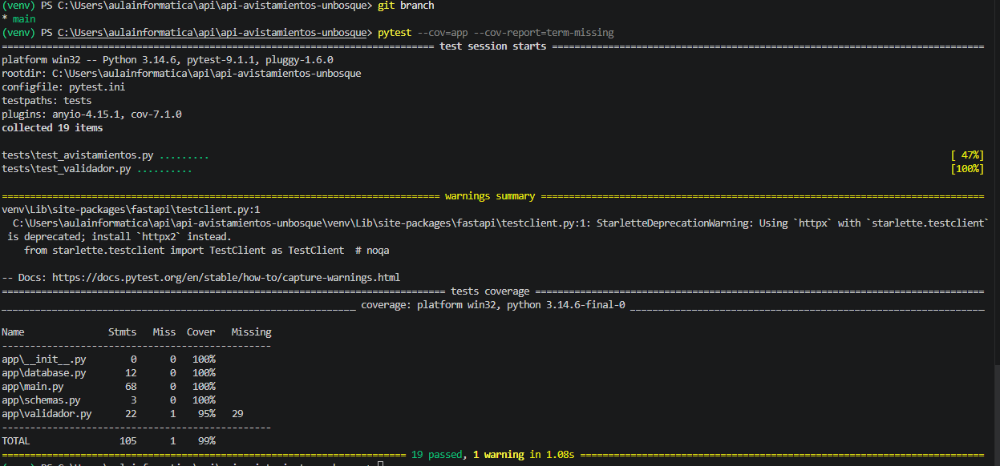
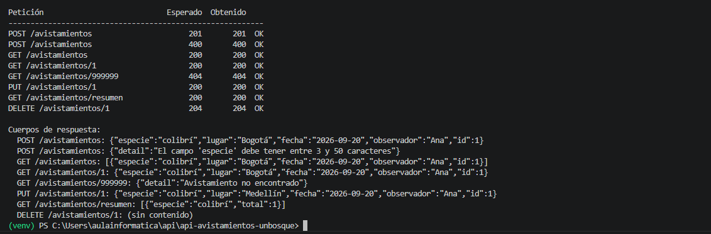
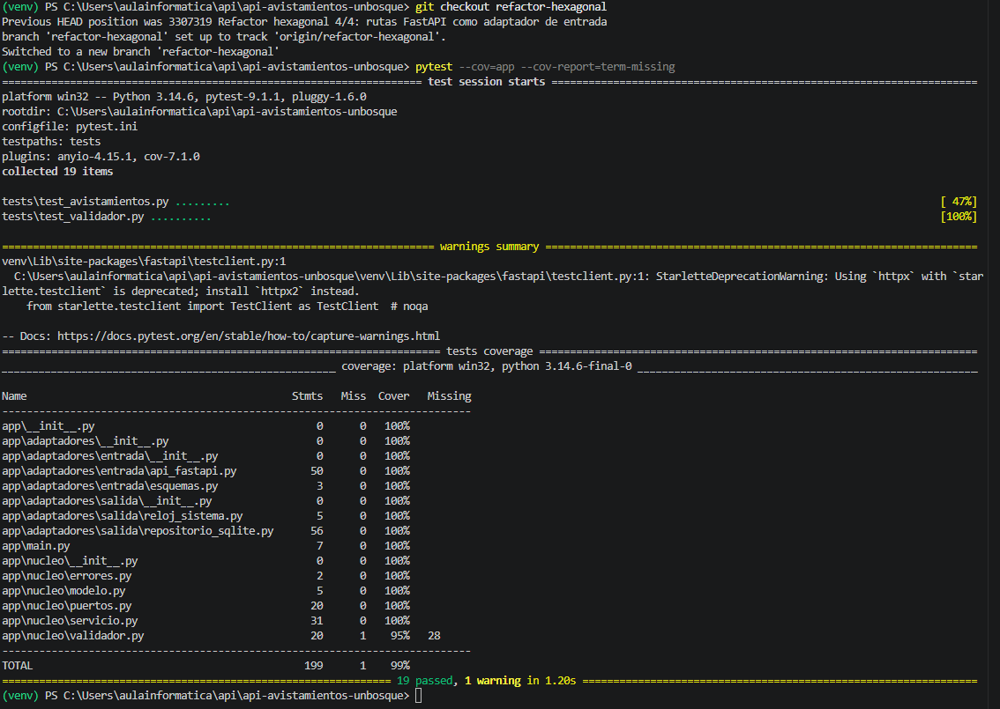
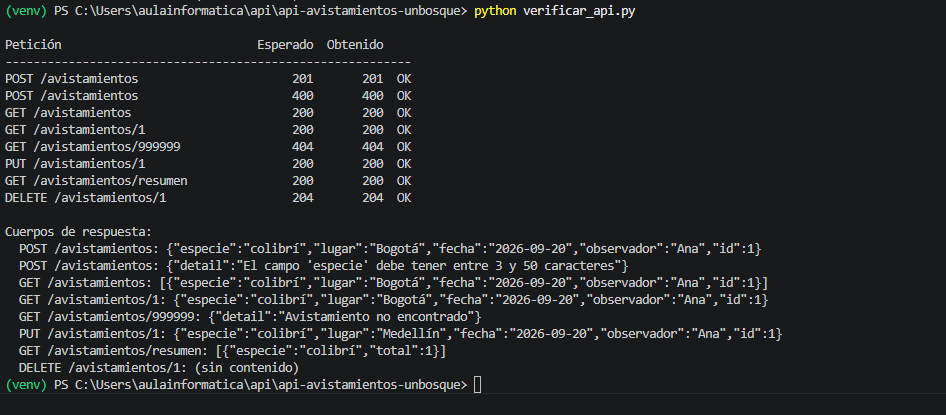

# Taller 5: Clean Architecture y arquitectura hexagonal

Ingeniería de Software 2 (ISW-2)  
Martin Daniel Porto Gutierrez  
Universidad El Bosque, 11 de noviembre de 2026  

## 1. Parte 1. Investigación

### Pregunta 1. Cockburn (2005): el problema, puertos, adaptadores y simetría

Cockburn (2005) parte de un problema que veía repetirse: la lógica de negocio se mezcla con el código de la interfaz de usuario. Esto hace difícil escribir pruebas automáticas, porque la lógica queda atada a detalles visuales, e impide que la aplicación sea usada por otro programa o por un proceso por lotes en vez de una persona. Además, aunque los equipos crean capas nuevas prometiendo no meterles lógica de negocio, nada hace cumplir esa promesa y la lógica se vuelve a colar (Cockburn, 2005). El autor ve el mismo problema del lado de la base de datos: si la aplicación depende de una base real, no se puede trabajar cuando esa base no está disponible (Cockburn, 2005).

Para resolverlo, propone que la aplicación se comunique con el exterior solo a través de puertos. Un puerto es una API definida según el propósito de la conversación, como un puerto de hardware al que se puede conectar cualquier dispositivo que cumpla su protocolo. Un adaptador es la pieza que traduce entre esa API y una tecnología concreta: una interfaz gráfica, una herramienta de pruebas, una base SQL o una base simulada en memoria. A un mismo puerto se le pueden conectar varios adaptadores (Cockburn, 2005).

Hay simetría porque, para Cockburn, el usuario y la base de datos son ambos agentes externos que hablan con la aplicación por medio de puertos. Lo que importa no es izquierda o derecha, sino dentro o fuera. Cambiar la interfaz gráfica por una herramienta de pruebas, o una base SQL por un archivo plano, no debería alterar lo que pasa dentro de la aplicación. Por eso una sola solución resuelve los dos problemas (Cockburn, 2005).

### Pregunta 2. Martin (2012): los círculos y la regla de dependencia

Martin (2012) dibuja cuatro círculos concéntricos. En el centro están las entidades, que son las reglas de negocio generales de la empresa y lo que menos cambia ante cambios externos. Luego vienen los casos de uso, que son las reglas propias de la aplicación y dirigen el flujo de datos hacia y desde las entidades. El tercer círculo son los adaptadores de interfaz, que convierten los datos entre el formato que usan los casos de uso y el formato de lo externo; aquí están los controladores, los presentadores y el código SQL. En el círculo exterior están los frameworks y drivers, como la base de datos y el framework web, donde casi solo hay código de conexión (Martin, 2012). Martin aclara que los cuatro círculos son solo un ejemplo: puede haber más o menos (Martin, 2012).

La regla de dependencia dice que las dependencias del código fuente solo pueden apuntar hacia adentro. Prohíbe que algo de un círculo interno nombre cualquier cosa declarada en uno externo: una clase, una función o una variable. También prohíbe que los círculos internos usen formatos de datos de los externos, en especial los que genera un framework, para que los cambios de afuera no afecten lo de adentro (Martin, 2012).

### Pregunta 3. Cómo guarda datos el caso de uso sin depender de la base de datos

Clean Architecture resuelve la contradicción con el principio de inversión de dependencias. El caso de uso no llama directamente a la clase que guarda en la base de datos. En cambio, llama a una interfaz que se declara en su propio círculo, y la clase concreta, ubicada en un círculo externo, implementa esa interfaz. Así, durante la ejecución el control va del caso de uso hacia afuera, pero en el código fuente la dependencia apunta hacia adentro, porque es la clase de afuera la que conoce la interfaz de adentro (Martin, 2012). Martin lo explica con un caso de uso que debe entregar resultados a un presentador externo a través de una interfaz de salida (Martin, 2012). Palermo describe el mismo mecanismo para los datos: las interfaces de los repositorios viven en el centro y sus implementaciones en la infraestructura, y se inyectan al ejecutar la aplicación (Palermo, 2008).

En la API de avistamientos, por ejemplo, el servicio de casos de uso necesita guardar un avistamiento. Para eso usa la interfaz RepositorioAvistamientos, que está dentro del núcleo y solo declara métodos como guardar u obtener. La clase RepositorioSQLite, que está fuera, implementa esa interfaz con consultas SQL. Al arrancar, main.py crea el repositorio SQLite y se lo entrega al servicio. El servicio nunca importa nada de SQLite, así que se podría cambiar la base de datos sin tocar los casos de uso.

### Pregunta 4. Comparación entre hexagonal, cebolla y Clean Architecture

Las tres arquitecturas comparten la misma idea central: las reglas de negocio van en el centro y no dependen de nada externo, mientras que la base de datos, la interfaz y los frameworks quedan en el borde como detalles reemplazables. Las tres logran esto con interfaces definidas por el núcleo e implementadas afuera, de modo que las dependencias apuntan hacia adentro. El mismo Martin (2012) dice que las arquitecturas anteriores, incluidas la de Cockburn y la de Palermo, varían en los detalles pero buscan el mismo objetivo: separar responsabilidades para que el sistema sea fácil de probar e independiente de frameworks, interfaz y base de datos. Palermo (2008) también relaciona su propuesta con la de Cockburn.

Lo que cambia de una a otra es lo siguiente:

- El vocabulario: Cockburn habla de puertos y adaptadores (Cockburn, 2005); Palermo, de un modelo de dominio rodeado de capas (Palermo, 2008); y Martin, de entidades, casos de uso, adaptadores de interfaz y frameworks (Martin, 2012).
- El número de capas: Cockburn solo distingue dentro y fuera, y aclara que los seis lados del hexágono no tienen significado (Cockburn, 2005). Palermo pone varias capas alrededor del modelo de dominio, pero dice que su número depende de cada aplicación (Palermo, 2008). Martin propone cuatro círculos, aunque aclara que son ilustrativos (Martin, 2012).
- El énfasis: Cockburn se enfoca en la simetría entre el lado del usuario y el de la base de datos, y en poder manejar y probar la aplicación sin interfaz ni base real (Cockburn, 2005). Palermo parte de una crítica a la arquitectura por capas tradicional, donde todo termina dependiendo del acceso a datos (Palermo, 2008). Martin presenta su propuesta como una síntesis, resumida en una sola regla explícita, y agrega reglas sobre qué datos pueden cruzar las fronteras (Martin, 2012).

### Pregunta 5. ¿Se justifica aplicar Clean Architecture a esta API?

Considero que no se justifica aplicar Clean Architecture completa a esta API, pero sí una separación más liviana entre el núcleo y la tecnología.

El costo es concreto. Al aplicar la arquitectura hexagonal en este taller, el proyecto pasó de 4 a 10 archivos de código (sin contar los __init__.py) y de 105 a 199 sentencias, sin agregar ninguna funcionalidad. Clean Architecture completa costaría aún más: con cuatro círculos (Martin, 2012), cada uno de los seis endpoints necesitaría su propio caso de uso, con sus estructuras de entrada y salida y su presentador, y la mayoría de esas clases solo pasarían datos de un lado a otro. El mismo Palermo (2008) aclara que su propuesta está pensada para aplicaciones empresariales complejas y de larga vida, y no para sitios pequeños.

Al mismo tiempo, hay un beneficio real y también concreto. Martin (2012) señala que separar las reglas de negocio permite probarlas sin base de datos ni servidor web. En este taller eso se comprobó: el servicio funcionó conectado a un repositorio en memoria, sin SQLite ni FastAPI. Además, cambiar SQLite por otra base solo exigiría escribir un adaptador nuevo y cambiar una línea en main.py.

Por eso tomo una posición intermedia. Para una API de este tamaño, basta con una separación de solo dos zonas, dentro y fuera, como propone Cockburn (2005). Esa separación da el beneficio principal, que es probar y cambiar la tecnología sin tocar la regla de negocio, sin pagar el costo de todas las capas de Clean Architecture. Si la API creciera en reglas y endpoints, se podría agregar más capas después.

## 2. Repositorio

**Repositorio:** [https://github.com/martiportog16/api-avistamientos-unbosque](https://github.com/martiportog16/api-avistamientos-unbosque)

**Rama con el refactor:** [refactor-hexagonal](https://github.com/martiportog16/api-avistamientos-unbosque/tree/refactor-hexagonal)

La rama main se dejó sin cambios y corresponde al estado anterior al refactor (el “antes”). La rama refactor-hexagonal contiene el refactor completo (el “después”). El refactor se hizo en commits pequeños; en cada uno la aplicación sigue funcionando:

| Commit | Cambio |
|---|---|
| 1/4 | Mover el validador al núcleo y extraer el puerto Reloj. El validador deja de crear su propio reloj y lo recibe por el puerto. |
| 2/4 | Crear el puerto RepositorioAvistamientos y el adaptador SQLite. Todo el SQL sale de main.py. |
| 3/4 | Crear el servicio de aplicación con los casos de uso (listar, ver, crear, actualizar, eliminar, resumen). |
| 4/4 | Mover las rutas de FastAPI a un adaptador de entrada. main.py queda solo conectando las piezas. |
| Ajuste | Docstrings en los métodos abstractos de los puertos, para que no cuenten como líneas sin ejecutar en la cobertura. |

## 3. Arquitectura elegida y organización del código

Se eligió la arquitectura hexagonal, también llamada de puertos y adaptadores (Cockburn, 2005). La aplicación se divide en dos zonas: el núcleo, que contiene las reglas de negocio, y los adaptadores, que conectan el núcleo con las tecnologías externas. El núcleo define puertos (interfaces) y no conoce ninguna tecnología; los adaptadores implementan o usan esos puertos. Los adaptadores de entrada manejan la aplicación (en este caso, la API REST con FastAPI) y los adaptadores de salida son usados por ella (la base de datos SQLite y el reloj del sistema).

Razones de la elección:

- La API es pequeña: seis endpoints y una regla de validación. La arquitectura hexagonal solo exige decidir si cada pieza está dentro o fuera del núcleo, lo que permite aplicarla completa sin agregar capas que en este proyecto quedarían vacías.
- El código ya tenía un puerto sin nombrarlo así: el validador recibía un reloj, que en producción era RelojSistema y en las pruebas era RelojFijoStub. El refactor extiende esa misma idea a la base de datos y a la capa web.
- La simetría que propone Cockburn (2005) entre el lado del usuario y el lado de la base de datos se ve en las pruebas: el TestClient de las pruebas de integración y el RelojFijoStub de las pruebas unitarias son otros adaptadores conectados a los mismos puertos.

### Estructura de carpetas

| Archivo | Zona | Responsabilidad |
|---|---|---|
| app/nucleo/modelo.py | Núcleo | Avistamiento como dataclass, sin FastAPI, Pydantic ni SQL. |
| app/nucleo/validador.py | Núcleo | Regla de negocio (especie, lugar, observador y fecha). |
| app/nucleo/puertos.py | Núcleo | Puertos de salida: Reloj y RepositorioAvistamientos. |
| app/nucleo/servicio.py | Núcleo | Casos de uso; es el punto por donde se maneja la aplicación. |
| app/nucleo/errores.py | Núcleo | AvistamientoNoEncontrado, error del núcleo sin significado HTTP. |
| app/adaptadores/entrada/api_fastapi.py | Entrada | Endpoints REST: traduce JSON al modelo y errores a códigos 400/404. |
| app/adaptadores/entrada/esquemas.py | Entrada | Formato JSON de entrada y salida (Pydantic). |
| app/adaptadores/salida/repositorio_sqlite.py | Salida | Implementa RepositorioAvistamientos con SQLite. |
| app/adaptadores/salida/reloj_sistema.py | Salida | Implementa Reloj con la fecha del sistema. |
| app/main.py | Composición | Crea los adaptadores y los conecta con el núcleo. |

### Dónde quedó cada parte del código original

| Antes | Después |
|---|---|
| app/main.py (rutas) | app/adaptadores/entrada/api_fastapi.py |
| app/main.py (SQL de cada ruta) | app/adaptadores/salida/repositorio_sqlite.py |
| app/main.py (validar y luego guardar) | app/nucleo/servicio.py |
| app/database.py | app/adaptadores/salida/repositorio_sqlite.py |
| app/schemas.py | app/adaptadores/entrada/esquemas.py |
| app/validador.py (reglas) | app/nucleo/validador.py |
| app/validador.py (RelojSistema) | app/adaptadores/salida/reloj_sistema.py |

### Diagrama de dependencias

*Figura 1. Dirección de las dependencias. Cada flecha indica que un archivo importa a otro.*

Los dos adaptadores de salida importan el puerto que implementan, y el adaptador de entrada importa el servicio. Ningún archivo del núcleo importa algo de app/adaptadores; esto se comprobó revisando los import de cada archivo. El único archivo que conoce a la vez el núcleo y los adaptadores concretos es app/main.py, que arma la aplicación al arrancar.

## 4. Evidencia de funcionamiento y cobertura

Las pruebas se ejecutaron en las dos ramas con el comando pytest --cov=app --cov-report=term-missing. Para la API se usó el script docs/verificar_api.py, que envía las mismas 8 peticiones (los seis endpoints más un caso de error 400 y uno 404) a la API en ejecución (uvicorn app.main:app). En las dos ramas se partió de una base de datos vacía, para que los resultados fueran comparables.

### Antes del refactor (rama main)

*Figura 2. Pruebas y cobertura antes del refactor.*

*Figura 3. Respuestas de la API antes del refactor.*

### Después del refactor (rama refactor-hexagonal)

*Figura 4. Pruebas y cobertura después del refactor.*

*Figura 5. Respuestas de la API después del refactor.*

### Resumen

| Medida | Antes | Después |
|---|---|---|
| Pruebas que pasan | 19 de 19 | 19 de 19 |
| Cobertura total | 99 % | 99 % |
| Líneas sin cubrir | 1 (validador.py, línea 29) | 1 (nucleo/validador.py, línea 28) |

La cobertura se mantuvo en 99 %. La única línea sin cubrir es la misma en los dos momentos: el error de fecha vacía del validador, que ninguna prueba ejercita. Solo cambió su número de línea, porque el archivo se movió y cambiaron sus import. El total de sentencias pasó de 105 a 199 porque el refactor agregó archivos (puertos, servicio, modelo y adaptadores), y todas las sentencias nuevas quedaron cubiertas por las mismas pruebas.

### La API responde igual

| Petición | Esperado | Antes | Después |
|---|---|---|---|
| POST /avistamientos (datos válidos) | 201 | 201 | 201 |
| POST /avistamientos (especie "ab") | 400 | 400 | 400 |
| GET /avistamientos | 200 | 200 | 200 |
| GET /avistamientos/1 | 200 | 200 | 200 |
| GET /avistamientos/999999 | 404 | 404 | 404 |
| PUT /avistamientos/1 | 200 | 200 | 200 |
| GET /avistamientos/resumen | 200 | 200 | 200 |
| DELETE /avistamientos/1 | 204 | 204 | 204 |

Además de los códigos, los cuerpos de respuesta son idénticos en las dos ramas (figuras 3 y 5), incluidos los mensajes de error.

### Verificación de cada commit

Como buena práctica, también se verificó que las pruebas pasaran en cada commit intermedio del refactor, para comprobar que ningún paso dejó la aplicación rota:

| Commit | Descripción | Resultado |
|---|---|---|
| 9845879 | 1/4: validador al núcleo y puerto Reloj | 19 passed |
| 34ae1a1 | 2/4: puerto de repositorio y adaptador SQLite | 19 passed |
| 2501606 | 3/4: servicio de aplicación | 19 passed |
| 3307319 | 4/4: rutas como adaptador de entrada | 19 passed |

También se probó el servicio del núcleo conectándolo a un repositorio en memoria, sin SQLite ni FastAPI, y todos los casos de uso funcionaron igual (incluidos los errores de validación y de avistamiento no encontrado). Esto muestra en la práctica que las reglas de negocio ya no dependen de la base de datos ni del framework.

## 5. Lo más difícil de separar

Lo más difícil fue separar el acceso a la base de datos de las rutas. En el código original cada endpoint mezclaba tres cosas en pocas líneas: la validación, la consulta SQL y la respuesta HTTP. Por ejemplo, el endpoint de eliminar ejecutaba el DELETE y luego miraba cur.rowcount para decidir si respondía 404. Al llevar el SQL al repositorio había que decidir qué devolvía el puerto sin que se filtrara un concepto de HTTP hacia el núcleo. La solución fue que el repositorio informe solamente si encontró o no el registro (None o False), que el servicio convierta eso en un error propio del núcleo (AvistamientoNoEncontrado) y que solo el adaptador de FastAPI lo traduzca a un 404.

También fue difícil decidir qué hacer con los esquemas de Pydantic. Ya existían y habría sido más rápido usarlos dentro del núcleo, pero son parte de FastAPI, y el núcleo habría quedado dependiendo del framework. Por eso se creó un modelo propio (una dataclass) y se aceptó el costo de traducir entre los dos formatos en el adaptador de entrada.

Por último, el validador creaba su propio RelojSistema cuando no recibía uno. Eso parecía cómodo, pero hacía que el núcleo conociera un adaptador concreto, así que el reloj pasó a ser obligatorio y main.py se encarga de entregarlo. Todo esto se hizo sin cambiar la lógica de las pruebas: solo se actualizaron las rutas de los import.

## Referencias

Cockburn, A. (2005, 4 de septiembre). Hexagonal architecture. https://alistair.cockburn.us/hexagonal-architecture/

Martin, R. C. (2012, 13 de agosto). The Clean Architecture. The Clean Code Blog. https://blog.cleancoder.com/uncle-bob/2012/08/13/the-clean-architecture.html

Palermo, J. (2008, 29 de julio). The Onion Architecture: part 1. https://jeffreypalermo.com/2008/07/the-onion-architecture-part-1/
